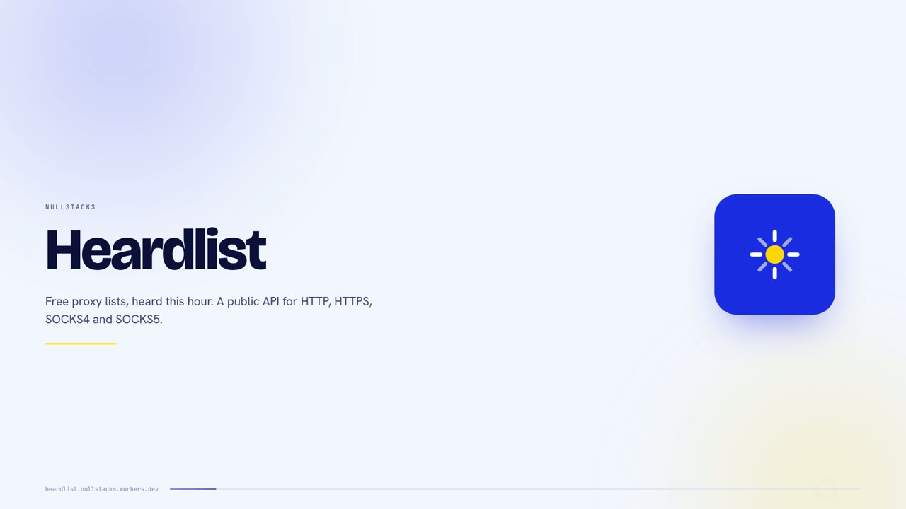

# Heardlist

**[▶ Watch the 24-second launch video](docs/media/launch.mp4)**

[](docs/media/launch.mp4)

<p align="center">
  <a href="https://heardlist.pushkarsingh4343.workers.dev"><strong>Live demo</strong></a> ·
  <a href="https://heardlist.pushkarsingh4343.workers.dev/docs/">API docs</a> ·
  <a href="#api">Endpoints</a> ·
  <a href="#deploy">Deploy your own</a>
</p>

A free, public proxy-list API on Cloudflare Workers, with a landing page and docs.
No API key, CORS open.

- **API**: `GET /v1/proxies`, `/v1/random`, `/v1/{http|https|socks4|socks5}.txt`, `/v1/stats`, `/v1/sources`, `/v1/health`
- **Landing page**: `/` (live station card, query playground, source tiers, safety)
- **Docs**: `/docs/`
- **Data**: monosans (verified, tier 1) + proxifly (unverified, tier 2) + TheSpeedX (unverified, tier 3),
  refreshed hourly by a Cron Trigger into KV, de-duplicated, private addresses removed.

## API

Base URL on the live deployment: `https://heardlist.pushkarsingh4343.workers.dev`

| Endpoint | Description |
|---|---|
| `GET /v1/proxies` | Filter and page the pooled list. Params: `protocol`, `anonymity`, `country`, `source`, `verified`, `max_latency`, `sort` (`quality\|latency\|random`), `format` (`json\|txt\|csv`), `scheme`, `limit` (≤ 5000), `offset`. |
| `GET /v1/random` | Random draw (`limit` defaults to 1). Never cached. |
| `GET /v1/http.txt` · `/v1/https.txt` · `/v1/socks4.txt` · `/v1/socks5.txt` | Plain `host:port` list per protocol (add `?scheme=true` for `scheme://host:port` lines). |
| `GET /v1/stats` | Totals, per-protocol/per-source counts, country count, freshness. |
| `GET /v1/sources` | The upstream sources with per-source fetch status. |
| `GET /v1/health` | `ok: true` when the list is fresh and non-empty (503 otherwise). |
| `POST /v1/admin/refresh` | Trigger a refresh; needs `Authorization: Bearer $ADMIN_TOKEN`. |

Example:

```bash
curl "https://heardlist.pushkarsingh4343.workers.dev/v1/proxies?protocol=socks5&country=US&max_latency=2&limit=5"
```

## Deploy

[](https://deploy.workers.cloudflare.com/?url=https://github.com/nullstacks/heardlist)

```bash
npm install
npx wrangler login

# 1. Create the KV namespace and paste the returned id into wrangler.toml
npx wrangler kv namespace create PROXIES

# 2. (Optional) delete the [[unsafe.bindings]] rate-limit block in wrangler.toml
#    if you don't want the default 120 req/min/IP limit.

# 3. Deploy
npx wrangler deploy
```

The button creates the KV namespace and deploys automatically; what it cannot do:

- `npx wrangler secret put ADMIN_TOKEN` if you want manual `POST /v1/admin/refresh`.
- The hourly cron + first refresh are set up by the deploy itself.

The list is empty until the first cron run (minute 7 of every hour). To fill it immediately:

```bash
npx wrangler secret put ADMIN_TOKEN        # pick any long random string
curl -X POST -H "Authorization: Bearer ***" https://<your-worker>.workers.dev/v1/admin/refresh
```

Then check `https://<your-worker>.workers.dev/v1/stats`.

Local dev: `npm install && npx wrangler dev --test-scheduled`, then `curl "http://localhost:8787/__scheduled"` to run the refresh. Run the test suite with `npm test`.

## Important: plan limits

The hourly refresh downloads and parses several MB of JSON/text (proxifly's SOCKS5 file alone has ~45k lines).
That is likely to exceed the **Workers Free** per-invocation CPU limit. Use **Workers Paid** (Cron Triggers get a much
higher CPU allowance), or shrink the work: lower `MAX_PER_SOURCE_PROTOCOL` in `src/ingest.js`, or drop the proxifly source.

## Layout

```
src/index.js     router, rate limit, edge cache, cron entry
src/ingest.js    source fetchers + normalisation + refresh (per-source KV keys, failures keep old data)
src/query.js     index build (dedupe + quality sort), filters, JSON/TXT/CSV formatting
public/          landing page (index.html), docs (docs/index.html), assets, _headers
test/api.test.js node:test suite (fake KV + fake fetch; run with `npm test`)
```

## Behaviour worth knowing

- "verified" means the upstream source verifies what it publishes (monosans). Heardlist does **not** re-check proxies.
- `https` entries are plain HTTP proxies a source flags as HTTPS-capable; their `url` starts with `http://`.
- Each source's data expires after 12 h without a successful refresh, so a dead cron yields an empty list, not ancient addresses.
- A failing source keeps its previous entries; a partially failing source keeps old entries for just the failed protocols.
- Anonymity is only provided by proxifly; other entries have `anonymity: null`.

## Deployment status

Deployed and verified live on Cloudflare Workers (`workers.dev`): all three sources fetch OK, landing page and docs
serve 200, `/v1/stats` shows non-zero counts for all three sources, filters/formats verified with live curls.
The node:test suite passes (6/6) against fixtures and a fake KV/fetch.
